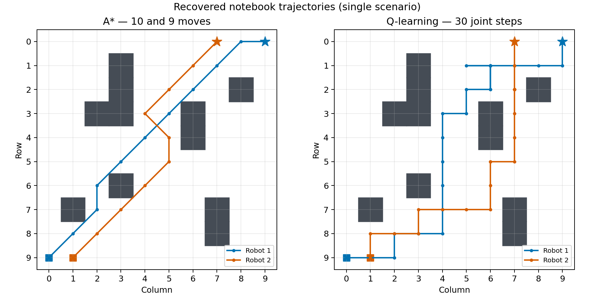
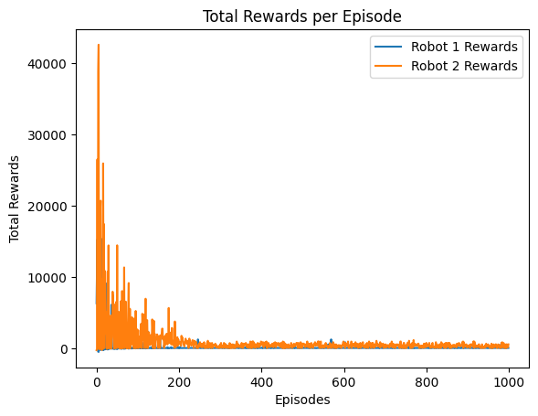
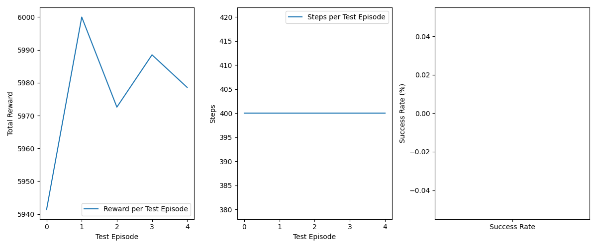
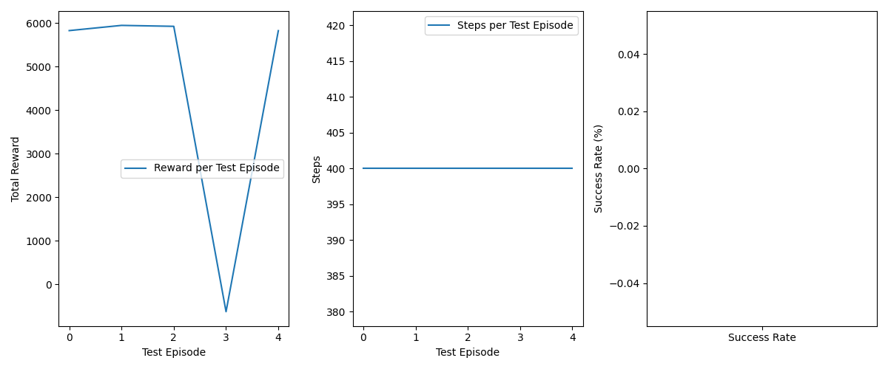
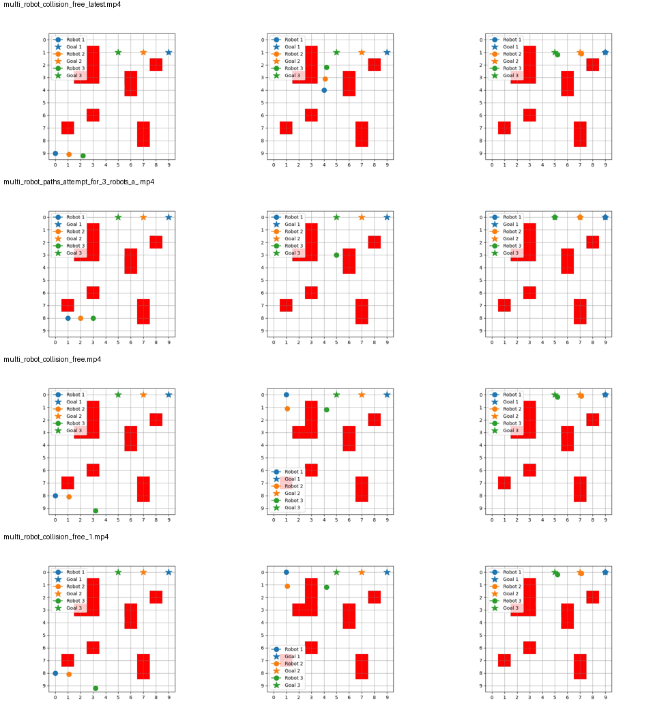

# Multi-Robot Path Planning Using Classical Search and Reinforcement Learning

An exploratory research project investigating multi-robot navigation in discrete grid environments using classical A* search, tabular Q-learning, and deep Q-networks (DQN). The work examines obstacle avoidance, coordination, dynamic pickup-and-delivery tasks, and the limitations of reward-driven navigation.

> **Research status:** Historical prototype with recovered experimental artifacts. Results are descriptive, not a validated benchmark or a claim of optimal or universally collision-free planning. The notebook and warehouse DQN are separate experimental formulations.



*Figure 1. Trajectories reconstructed from the notebook's saved path outputs. Squares denote starts, stars denote goals, and dark cells denote obstacles. Repeated locations represent waiting or revisiting; the Q-learning path is the last completed training trajectory, not a proven shortest path.*

## Research objectives

- Investigate multi-robot navigation with discrete movements and obstacle constraints.
- Compare a prioritized A* prototype with independent tabular Q-learning on a fixed two-robot scenario.
- Explore DQN-based navigation for dynamic warehouse pickup and delivery.
- Examine reward shaping, collision events, and fixed-fleet observation limitations.

## 1. Classical search and tabular Q-learning

The recovered `Final_Astar_QL.ipynb` contains the most complete comparative experiment. A separate exploratory Gym environment in the notebook supports eight-direction actions, position-plus-goal observations (4N features), and randomly relocated obstacles; the A*/QL comparison itself uses a fixed static map, not that Gym environment.

### Scenario and algorithm settings

| Setting | A* | Tabular Q-learning |
|---|---|---|
| Grid | 10 × 10 | 10 × 10 |
| Robots | 2 | 2 |
| Static obstacle cells | 11 | 11 |
| Starts (row, column) | (9,0), (9,1) | (9,0), (9,1) |
| Goals (row, column) | (0,9), (0,7) | (0,9), (0,7) |
| Movement | 8 directions | 4 cardinal directions |
| Representation | Priority queue, spatial path exclusion | Two independent 100 × 4 Q-tables |
| Learning rate | — | 0.05 |
| Discount factor | — | 0.95 |
| Exploration epsilon | — | 0.1 (constant) |
| Step reward | — | −1 |
| Goal reward | — | +100 on goal occupancy |
| Collision handling | Second path excludes first path cells | Proposed same-cell moves reverted |
| Episode termination | Goal found or search exhausted | Both robots simultaneously at goals; no step cap |

A* uses unit edge costs and a Euclidean heuristic. The second robot avoids cells in the first robot's returned path. This is a spatially prioritized planner, not Conflict-Based Search (CBS) or a time-expanded MAPF solver. The Euclidean heuristic is not generally admissible for unit-cost diagonals, so optimality is not guaranteed.

Tabular Q-learning uses the update:

$$Q_i(s,a) \leftarrow (1-\alpha)Q_i(s,a)+\alpha[r+\gamma\max_{a'}Q_i(s',a')].$$

The notebook declares a −50 collision penalty but does not apply it in the training update. It counts and rejects proposed same-cell collisions; edge swaps are not checked. The goal reward can be received repeatedly. Despite some stale PPO labels, the executed comparison uses tabular Q-learning, not PPO.

### Recovered results

| Metric | Prioritized A* | Tabular Q-learning |
|---|---:|---:|
| Moves, robot 1 (saved trajectory) | 10 | 30 joint steps |
| Moves, robot 2 (saved trajectory) | 9 | 30 joint steps |
| Sum of trajectory step counts | 19 | 60 |
| Computation time (separate timed comparison) | 0.001017 s | 0.622216 s |

A* paths omit the start, whereas Q-learning paths include it. Counts above correct this inconsistency by using transitions. Q-learning steps include repeated positions and are not necessarily physical moves. The saved Q-learning trajectory is from the 3,000-episode cell; the timing is from a separate 1,000-episode run and includes training, not inference. These values are not a fair speed or optimality benchmark because movement sets, planning methods and timing scopes differ.

| Recovered training statistic | 3,000-episode cell | 1,000-episode cell |
|---|---:|---:|
| Mean joint steps per episode | 25.96 | 34.042 |
| Mean proposed same-cell collision events per episode | 0.88 (rounded) | 0.657 |
| Total proposed collision events | Not verified exactly | 657 |
| Total reward, robot 1 | — | 244,011 |
| Total reward, robot 2 | — | 975,150 |

The 3,000-episode output and a later logging cell disagree (25.54 steps and 0.78 collisions in the latter); notebook execution state is not fully reproducible. The notebook's hardcoded success rates and collision-rate curve are not valid independent evaluation metrics. Completed training episodes do not establish held-out success.



*Figure 2. Original saved reward output of the 1,000-episode notebook cell. No smoothing or synthetic training data added.*

## 2. Deep Q-network warehouse prototype

The custom OpenAI Gym environment models a grid warehouse with four corner delivery stations, random pickup locations, and task reassignment after delivery. Robots can take cardinal and diagonal actions. Global observations contain robot coordinates only (2N features); goals and task state are not observed by the DQN. Same-cell occupancy incurs a penalty rather than a hard collision constraint.

### Architecture and historical configuration

| Parameter | Value |
|---|---|
| Framework | TensorFlow / Keras, legacy OpenAI Gym |
| Network | 2N → Dense(24, ReLU) → Dense(24, ReLU) → Dense(8, linear) |
| Parameter count (2 / 5 robots) | 920 / 1,064 per network |
| Optimizer / loss | Adam / MSE |
| Learning rate / discount | 0.001 / 0.95 |
| Replay capacity / batch | 2,000 / 32 |
| Exploration | ε=1.0, multiplier 0.995, minimum threshold 0.01 |
| Historical training fleet / grid | 2 robots / 10 × 10 (notes) |
| Training budget | 400 episodes planned; ~53–54 completed (notes) |
| Recovered script defaults | 5 robots, 25 episodes, 300-step training loop |
| Environment horizon | 400 in recovered code; 100 in public version |
| Evaluation loop cap | 500 (environment normally ends earlier) |
| Checkpoint saving | Every 5 zero-indexed episodes |
| Initial tasks / delivery stations | 5 / 4 |

The network uses experience replay and a separate target model. A shared network receives the same global state for every robot, so greedy decisions are generally identical. The replay implementation assigns a global target to multiple action indices; this is not a validated multi-agent DQN formulation. Fixed input width also prevents directly loading weights trained with a different number of robots.

### Reward function

For each robot, +10 is awarded for delivery-station occupancy; elsewhere the reward is −1 plus an inverse Chebyshev-distance bonus when a goal exists. Each pair occupying the same cell contributes −5 to the global reward. This rewards occupancy rather than verified delivery and can encourage unintended behavior.

$$d_\infty(p,g)=\max(|p_x-g_x|,|p_y-g_y|),\qquad b(d)=1/(d+1).$$

### Historical evaluation

| Metric | 5 × 5 grid | 10 × 10 grid |
|---|---:|---:|
| Robots / checkpoint (filenames) | 2 / 5 | 2 / 5 |
| Episodes | 5 | 5 |
| Steps per episode | 400 | 400 |
| Reported success | 0% | 0% |
| Approximate mean cumulative reward | 5,976 | 4,579 |





*Figures 3–4. Original historical plots. Reward means are approximate readings from images; raw arrays and checkpoint contents have not been verified. `test_results.png` is identical to the 5×5 plot, not a third run.*

A separate historical log for checkpoint 50 reports mean reward −840.848095 over five episodes, with final episode reward −1215.134921 and 100 steps. The exact configuration is not fully established; do not combine with the 400-step results.

**Failure-mode hypothesis:** two robots sharing a delivery station earn 10+10−5=15 per step, or 6,000 over 400 steps. This explains a possible mechanism for high reward despite zero reported success. Actual occupancy behavior requires checkpoint replay to verify. Dynamic replenishment, uncleared goals and duplicate task insertion also undermine the meaning of the all-tasks-completed condition.

## 3. Simulation demonstrations



*Figure 5. First, middle and final frames sampled from the historical animations. The clips depict three robots navigating obstacle grids toward distinct goals. These are qualitative demonstrations; the generating algorithm and continuous-time collision guarantees have not been established. Two of the four recovered MP4s are exact duplicates.*

## 4. Repository layout and reproducibility

The public repository is an earlier snapshot; recovered local source and notebook must be added before all features described here are available from a clone.

```text
src/
  multi_robot_env.py       # warehouse environment
  dql_agent.py             # TensorFlow DQN
  train_agent.py           # training and checkpoint evaluation
  test_env.py              # random-action smoke test
  main.py                  # obsolete earlier entry point
  conflict_based_search.py # public version is a placeholder
  robot_testing_app.py     # PyQt configuration and report prototype
  task_grid_selection.py   # Pygame scenario selection
Final_Astar_QL.ipynb        # recovered classical / tabular experiments
docs/figures/              # recovered and reconstructed visuals
```

Install the original dependencies in a Python 3.10 virtual environment (historical Python version inferred from tracked bytecode and notebook logs):

```bash
python3.10 -m venv venv
source venv/bin/activate
pip install -r requirements.txt
pip install jupyter pandas
jupyter notebook Final_Astar_QL.ipynb
```

Dependency versions are not pinned; these instructions are not a tested clean-install guarantee. Notebook installation cells for Stable-Baselines3 and Shimmy are exploratory and not needed for the A*/tabular Q-learning comparison. Review cells before execution: tabular training has no step cap and animations require FFmpeg. Use saved notebook outputs for historical review rather than overwriting them.

For the warehouse evaluation, run from the directory containing a compatible checkpoint. The recovered script defaults to five robots and checkpoint 50; if the actual checkpoint was trained on two robots, explicitly select two robots instead. Example (only after verifying the model shape and preserving originals):

```bash
cd src
python -c 'from train_agent import test_dqn_agent; test_dqn_agent("dqn_model_5.weights.h5", num_robots=2, test_episodes=5)'
```

The function uses the default 10×10 grid and writes `test_rewards.npy`, `test_steps.npy`, `test_results.png` in the working directory. It does not expose a grid-size argument. Run in a separate scratch directory with `PYTHONPATH` pointing to `src` to avoid overwriting archival artifacts. `test_env.py` needs `render_mode=True` for its Pygame call. No retraining or checkpoint replay was performed for this documentation.

## 5. Limitations and next research steps

- Align action sets and scenario seeds for a fair classical/learning comparison; distinguish training time from inference time.
- Track actual deliveries, timeout, vertex/edge conflicts and throughput separately; repair task ownership, reset and replay-state copying.
- Use robot-specific goal-aware observations and action targets; verify checkpoint shapes and reproducibility.
- Correct path length conventions, select shortest completed trajectories explicitly, and add held-out evaluation and episode caps.
- Implement a genuine space-time baseline or CBS, then report results across multiple maps, fleet sizes and seeds.

The primary contribution is an exploratory implementation and empirical investigation, including negative results and identified limitations. No superiority, novelty, or publication claim is made.
